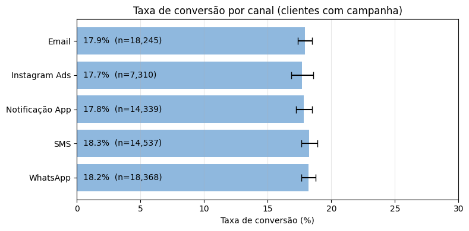
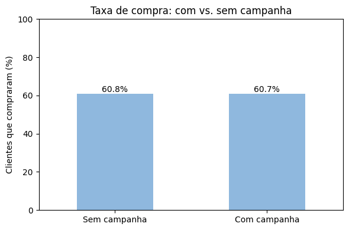
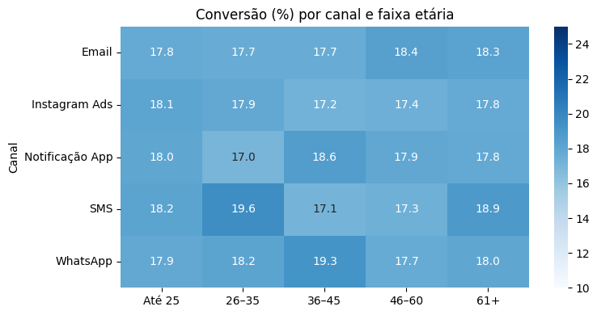

# Análise de conversão em campanhas de marketing

Projeto de conclusão do curso **Vem pra Dados Mulheres** (agosto de 2025).

[](https://colab.research.google.com/github/LidiaDias/campanha-marketing-eda/blob/main/analise-conversao-campanhas.ipynb)

## Contexto e objetivo

Uma empresa envia campanhas de marketing por vários canais (e-mail, SMS, WhatsApp, Instagram Ads e notificação de app) e quer saber **quais características definem o grupo de clientes com maior potencial de conversão**.

A análise busca responder:

- A conversão é mais comum em algum grupo (renda, idade, gênero)?
- O canal da campanha influencia a conversão?
- A frequência de campanhas está associada à conversão?
- As campanhas aumentam as compras?

## Resumo dos resultados

Entre os **72.799 clientes que receberam campanha**, **18,0% converteram**. Ao comparar os grupos com intervalo de confiança de 95% e teste qui-quadrado, **quase nenhuma diferença é estatisticamente significativa**:

| Variável | Taxa de conversão | p-valor | Leitura |
|---|---|---|---|
| Faixa etária | 17,8% a 18,2% | 0,954 | Sem diferença |
| Faixa de renda | 17,8% a 18,2% | 0,540 | Sem diferença |
| Canal | 17,7% a 18,3% | 0,710 | Sem diferença |
| Nº de campanhas recebidas | 17,9% a 19,4% | 0,685 | Sem diferença (grupos com 4+ campanhas são pequenos) |
| Gênero | F 18,3% / M 17,7% | 0,031 | Diferença pequena e marginal |

**Campanha vs. compra:** a taxa de compra é praticamente a mesma entre quem recebeu campanha e quem não recebeu (**60,7% vs. 60,8%; p = 0,82**). Ou seja, os dados não mostram evidência de que as campanhas aumentem as compras.







> **Conclusão:** neste conjunto de dados não há um perfil ou canal que se destaque. Recomendar segmentação por idade, renda ou canal não seria sustentado pelos números. O passo mais útil seria um **teste A/B** com grupo de controle para medir o efeito real das campanhas.

## Dados

- **Fonte:** base fornecida pelo curso, com dados **fictícios**, sem nenhuma informação pessoal identificável (compatível com a LGPD). Uso exclusivamente educacional.
- **Tamanho:** 150.000 clientes, uma linha por cliente (`analise-conversao-campanhas.csv`).
- **Pré-tratamento (Google Sheets):** a partir de três bases (cadastral, campanhas e compras), foram removidas colunas que não agregavam, criadas as contagens de campanhas e compras por cliente e integradas as três bases em uma tabela única.

| Coluna | Descrição |
|---|---|
| `cliente_id` | Identificador do cliente |
| `sexo` | Feminino ou Masculino |
| `idade` | Idade em anos |
| `renda_mensal` | Renda mensal em R$ (texto no formato brasileiro, ex.: `3.507,09`) |
| `quant_campanha_cliente` | Quantidade de campanhas recebidas |
| `canal` | Canal da campanha: Email, SMS, WhatsApp, Instagram Ads ou Notificação App |
| `abriu`, `clicou`, `converteu` | Resposta do cliente à campanha (Sim ou Não) |
| `quant_compra_cliente` | Quantidade de compras do cliente |

## Metodologia

1. **Tratamento:** valores ausentes não são erros, indicam clientes sem campanha ou sem compra; foram preenchidos com 0, "Sem campanha" ou "Não", conforme a coluna.
2. **Variáveis derivadas:** faixas de idade (até 25, 26–35, 36–45, 46–60, 61+) e de renda (até 2 mil, 2–4 mil, 4–7 mil). A faixa de R$ 6 mil a R$ 7 mil tem só 15 clientes contatados e foi unida à anterior.
3. **Base de análise:** a taxa de conversão foi calculada **somente entre quem recebeu campanha**. Incluir quem não recebeu (77.201 clientes, com 0% por definição) diluiria todas as taxas.
4. **Estatística:** para cada grupo, tamanho (n), taxa, **intervalo de confiança de 95%** (método de Wilson) e **teste qui-quadrado** para saber se a diferença entre grupos é real ou acaso.
5. **Visualização:** barras com intervalo de confiança e mapas de calor na mesma escala de cores.

## Limitações

- Os dados são fictícios e provavelmente sintéticos, o que explica a ausência de padrões.
- O pré-tratamento foi feito no Google Sheets, fora do notebook.
- Há inconsistências no funil: 8.619 clientes clicaram sem abrir a mensagem e 9.118 converteram sem clicar.
- A conversão não tem relação com a base de compras (60,0% dos que converteram compraram, contra 60,9% dos que não converteram).
- Cerca de 21% dos clientes têm renda exatamente R$ 1.500, o que sugere um piso aplicado na base.
- Análise descritiva: não permite afirmar causa e efeito.

## Próximos passos

- Validar com a área de negócio a definição de "conversão".
- Realizar um teste A/B (grupo contatado vs. grupo de controle).
- Incluir variáveis como histórico e valor das compras.

## Como executar

**No Colab (mais simples):** clique no botão "Abrir no Colab" no topo e execute todas as células. O notebook lê o CSV diretamente deste repositório.

**No seu computador:**

```bash
git clone https://github.com/LidiaDias/campanha-marketing-eda.git
cd campanha-marketing-eda
pip install pandas matplotlib seaborn scipy statsmodels jupyter
jupyter notebook analise-conversao-campanhas.ipynb
```

O notebook precisa de conexão com a internet, pois baixa o CSV do GitHub.

## Estrutura do repositório

```
├── README.md
├── analise-conversao-campanhas.ipynb   # notebook com toda a análise
├── analise-conversao-campanhas.csv     # base de dados
└── images/                             # gráficos usados neste README
```

## Tecnologias

Python, pandas, matplotlib, seaborn, scipy, statsmodels, Google Colab e Google Sheets.

## Autoria

**Ana Lídia Dias da Silva** · [GitHub](https://github.com/LidiaDias)

Ferramentas de IA foram usadas como apoio na organização da análise e da documentação.
